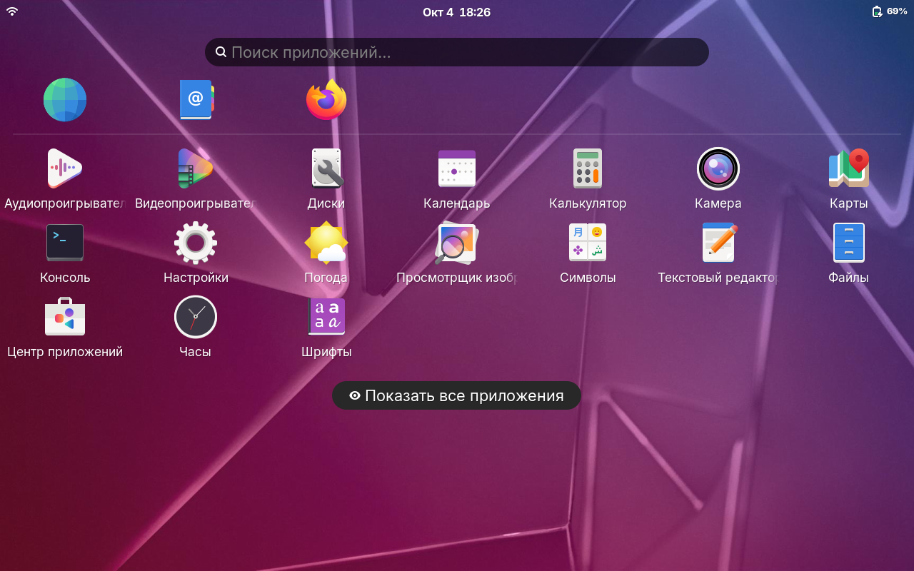
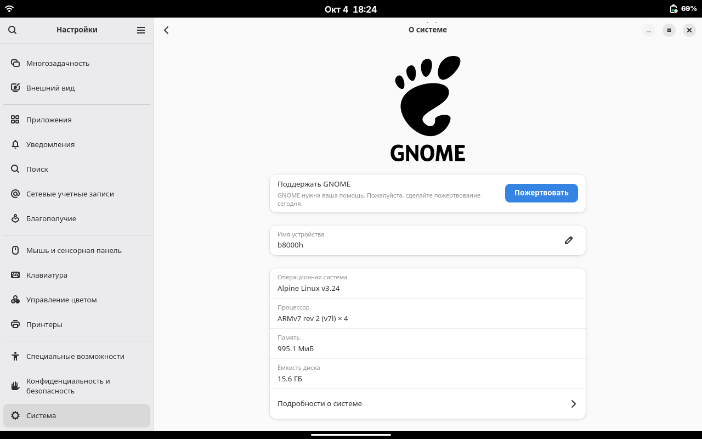
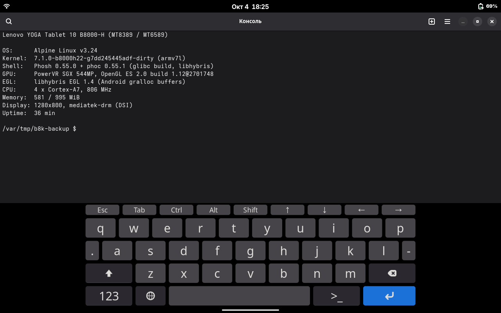

# Linux (Alpine + Phosh) для Lenovo YOGA Tablet 10 B8000-H

*English summary: an experimental port of mainline-based Linux 7.1 (TeamYogaBlade2
kernel + ~37 device patches) with Alpine Linux and the Phosh mobile shell to the
Lenovo YOGA Tablet 10 **B8000-H** (MT8389/MT6589, 3G). Display, touch, Wi-Fi,
speakers, charging and a GPU-composited Phosh (PowerVR SGX544 via libhybris and
the stock Android 4.4 blobs) work; the platform still crashes every 10–40 minutes.
Alpha quality, for enthusiasts. Documentation is in Russian.*

> **Статус: альфа для энтузиастов. Работа над портом приостановлена.**
> Ядро случайно падает раз в 10–40 минут (порча памяти, причина не найдена).
> Для повседневного использования не годится. Установка стирает пользовательские
> данные Android.

## Для какого устройства

Только **B8000-H** (3G): тип 60047 / Z0AJ, SoC MT8389 (семейство MT6589), плата
`BLADE10_ROW_3GDATA`, стоковая прошивка `B8000_A442_001_020_140620_WW_3GDATA`
(Android 4.4.2). На B8000-F и других версиях не проверялось — не ставьте.

## Что работает, а что нет

| Узел | Состояние |
|---|---|
| Загрузка с eMMC, ядро 7.1 | работает (BOOT прошивается fastboot'ом, система — в разделе USRDATA) |
| Экран 1280×800, подсветка, яркость, гашение при блокировке | работает (mediatek-drm, DSI) |
| GPU PowerVR SGX544 | композитор phoc рисует на GPU (60 fps) через libhybris и стоковые блобы Android 4.4 из раздела `/system` самого планшета |
| Оболочка Phosh, Firefox, приложения GNOME | работает; приложения рисуются процессором |
| Сенсорный экран | одно касание; мультитач не доходит |
| Wi-Fi (MT6628) | работает |
| Звук через динамики | работает |
| Батарея, зарядка до 2 А | работает; процент во время зарядки завышен |
| SSH, USB | работает |
| Наушники, микрофон | нет |
| Bluetooth | нет (не портирован) |
| 3G-модем, GPS, камеры | нет |
| Сон (suspend) | нет |
| Центр приложений (GNOME Software) | падает — ошибка самого GNOME Software на 32-битном ARM |
| GPU для самих приложений | невозможно: GTK4 требует OpenGL ES 3.0, у SGX544 только ES 2.0 |
| Аппаратное декодирование видео | нет |
| Стабильность | **случайные падения ядра раз в 10–40 минут**; `reboot` иногда зависает — держать Power 15–20 с |

Подробности по узлам — в `docs/`.

## Скриншоты

## Установка

**Готовых образов нет** — систему нужно собрать из исходников (см. ниже) и поставить
установщиком с microSD. Пошагово — [docs/INSTALL.md](docs/INSTALL.md). Кратко:

1. **Сделайте резервную копию уникальных разделов** (NVRAM, PRO_INFO, PROTECT_F/S)
   через SP Flash Tool → Readback. Без неё при неудаче можно потерять IMEI и калибровки.
2. Скачайте стоковую прошивку `B8000_A442_001_020_140620_WW_3GDATA` — она нужна для
   возврата на Android.
3. Соберите `boot.img` (ядро с установщиком) и образ установщика для microSD.
4. Прошейте ядро: `fastboot flash boot <файл>`.
5. Включите планшет с картой: установщик сам скопирует систему в раздел USRDATA
   (прогресс на экране) и загрузит Phosh.

Возврат на Android — [docs/RETURN-TO-ANDROID.md](docs/RETURN-TO-ANDROID.md).

## Сборка из исходников

- Среда — WSL с Alpine (сборка ядра clang/LLVM): `linux-port/build-safe-image.sh`.
- Ядро — [TeamYogaBlade2/linux](https://github.com/TeamYogaBlade2/linux/tree/blade/v7.1) `blade/v7.1` @ `7dd245445adf`
  плюс патчи из `linux-port/patches/`.
- Внешние модули: GPU (`linux-port/drivers/pvrsrvkm`, `dc_nohw`, `ion-legacy`),
  Wi-Fi (`linux-port/drivers/mt6628`), звук.
- Корневая система — `linux-port/build-rootfs.sh` (Alpine 3.24 armv7, `UI_PROFILE=phosh`).
- GPU-стек: Debian armhf «островок» с libhybris (`linux-port/hybris/build-hybris.sh`) и phoc
  0.55.1 с патчем wlroots под Android EGL (`linux-port/hybris/build-phoc.sh`,
  `wlroots-0.20-hybris.patch`); устройство и замеры — [docs/g4-hybris.md](docs/g4-hybris.md).

## Структура

| Путь | Что там |
|---|---|
| `linux-port/patches/` | патчи ядра (DTS, драйверы MT6589, таймеры, MSDC, дисплей…) |
| `linux-port/drivers/` | внешние модули: PowerVR KM (DDK 1.12), ION, MT6628, звук |
| `linux-port/hybris/` | libhybris, phoc-gpu, патч wlroots, тесты GPU |
| `linux-port/gpu/` | запуск Services PowerVR, служба `b8k-gpu`, демо |
| `linux-port/initramfs/` | init с установщиком с microSD |
| `tools/` | SP Flash Tool readback/download-конфиги, сборка образов |
| `docs/` | заметки по узлам (GPU, звук, Wi-Fi, батарея…) |

## Ошибки и вопросы

[Issues](https://github.com/kz-creator/lenovo-b8000h-linux/issues) этого репозитория. Приложите `dmesg`, `/sys/fs/pstore/*`
(после падения) и `/var/log/phosh.log`.

## Благодарности

- [TeamYogaBlade2](https://github.com/TeamYogaBlade2/linux/tree/blade/v7.1) — ядро для семейства Yoga Tablet (blade);
- [lenovo-b8000_postmarketos_files](https://github.com/TeamYogaBlade2/lenovo-b8000_postmarketos_files) — материалы postmarketOS по B8000;
- [libhybris](https://github.com/libhybris/libhybris), Phosh/phoc, wlroots, Alpine Linux, Debian;
- исходники PowerVR DDK 1.12 для MT6589 (bq Aquaris 5 HD, GPL/MIT);
- участники темы B8000 на 4pda — стоковая прошивка.

## Лицензии

Собственный код и патчи ядра — GPL-2.0 ([LICENSE](LICENSE)), если в файле не указано иное
(SPDX-заголовки). Драйверы из исходников MediaTek/Lenovo — их исходные лицензии (GPL-2.0).
Патч wlroots — MIT, как сам wlroots (`linux-port/hybris/wlroots-LICENSE.txt`).
Проприетарные блобы Android (PowerVR, gralloc, прошивки Wi-Fi) ни в репозитории, ни в
образах **не распространяются**: система подключает стоковый раздел `system` вашего
планшета только для чтения и берёт их оттуда (`linux-port/rootfs/b8k-android-system.initd`).
