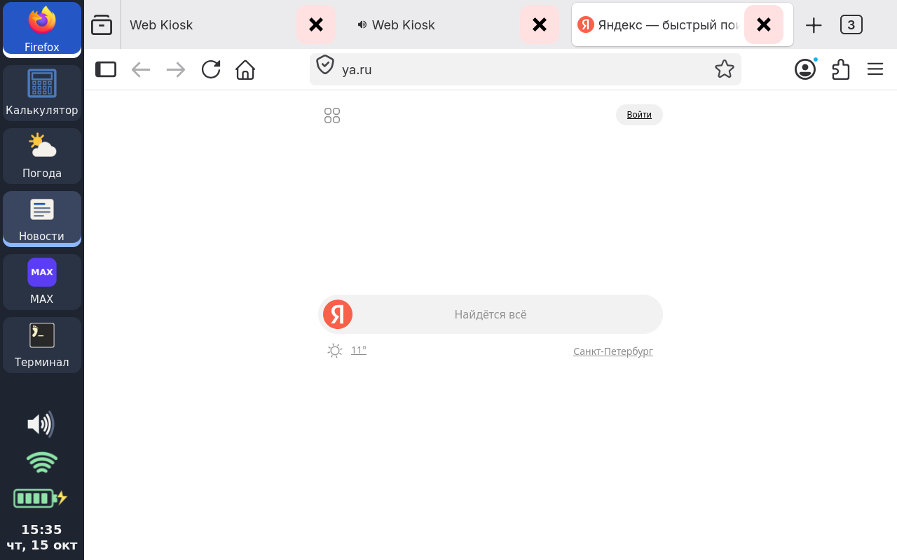
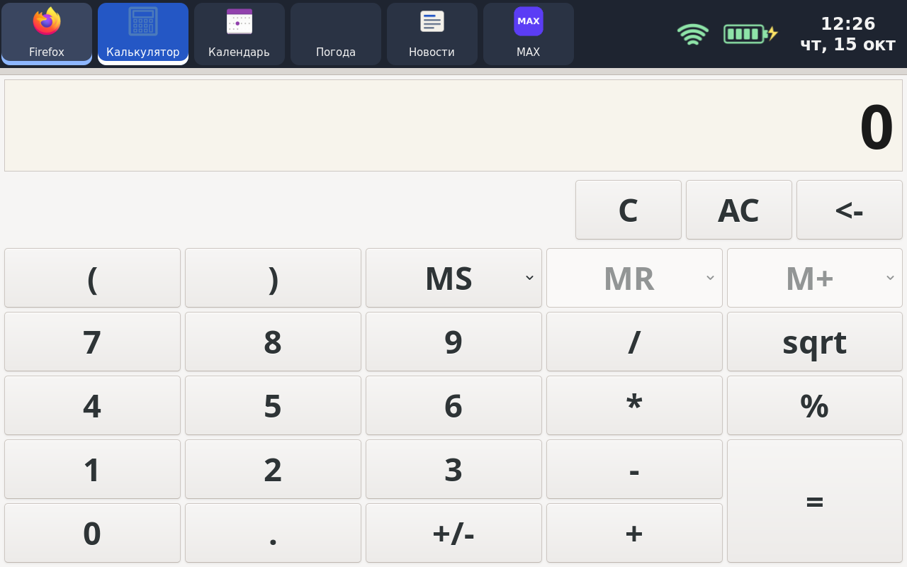
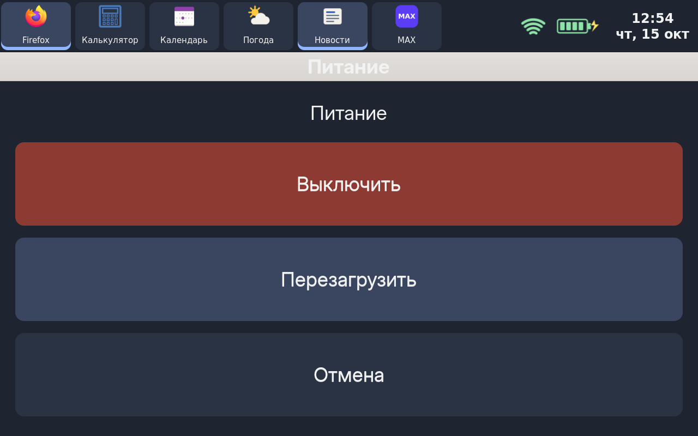

# Linux (Alpine) для Lenovo YOGA Tablet 10 B8000-H

*English summary: an experimental port of mainline-based Linux 7.1 (TeamYogaBlade2
kernel + 45 device patches) with Alpine Linux to the Lenovo YOGA Tablet 10
**B8000-H** (MT8389/MT6589, 3G). Display, touch, Wi-Fi, speakers and charging
work. The compositor phoc renders on the PowerVR SGX544 through libhybris and the
stock Android 4.4 blobs; a small touch shell (a waybar panel on the left with large program
buttons, b8k-shell) runs on it, with its own GTK3 programs. Ready-to-flash
images are built by GitHub Actions and published as releases. Until early October the kernel crashed every 10–40
minutes; kernel 23 ran an hour of full load at 1.2 GHz without a crash or a
memory error.
Alpha quality, for enthusiasts. Documentation is in Russian.*

> **Статус: альфа для энтузиастов.**
> По замерам до начала октября ядро падало раз в 10–40 минут. На ядре 23 час полной нагрузки на
> 1,2 ГГц (все четыре ядра и сверка 150 МБ памяти) прошёл без падений и
> ошибок памяти, но длительной проверки в обычной работе ещё не было. Установка стирает пользовательские
> данные Android.

## Для какого устройства

Только **B8000-H** (3G): тип 60047 / Z0AJ, SoC MT8389 (семейство MT6589), плата
`BLADE10_ROW_3GDATA`, стоковая прошивка `B8000_A442_001_020_140620_WW_3GDATA`
(Android 4.4.2). На B8000-F и других версиях не проверялось — не ставьте.

## Что работает, а что нет

| Узел | Состояние |
|---|---|
| Загрузка с eMMC, ядро 7.1 | работает (BOOT прошивается fastboot'ом, система — в разделе USRDATA) |
| Экран 1280×800, подсветка, яркость | работает (mediatek-drm, DSI); яркость — ползунок на панели, сохраняется |
| GPU PowerVR SGX544 | композитор phoc рисует на GPU (60 fps) через libhybris и стоковые блобы Android 4.4 из раздела `/system` самого планшета |
| Оболочка: домашний экран с плитками программ, панель слева, кнопка закрытия, яркость, громкость, Wi-Fi, батарея, часы | работает ([b8k-shell](https://github.com/trudenboy/b8k-shell)) |
| Программы: Firefox, MAX, Видео, Музыка, Файлы с галереей, Текст, Календарь, Погода, Новости, Раскраска, калькулятор, пасьянсы, терминал | работает; приложения рисуются процессором. Свои программы — лёгкие GTK3, каждая в своём репозитории `trudenboy/b8k-*`, ставятся подписанными пакетами Alpine; MAX — собственный клиент со счётчиком непрочитанных на кнопке |
| Видео | 480p H.264 — 30 к/с (программный декодер), 720p — нет |
| Экранная клавиатура | работает (wvkbd с крупной раскладкой, появляется в текстовом поле) |
| Сенсорный экран | одно касание; мультитач не доходит |
| Вибромотор | работает: толчок при нажатии кнопок панели |
| Wi-Fi (MT6628) | работает |
| Звук через динамики | работает; громкость — кнопками, индикатор на панели. Чистый тон на большой громкости дрожит ([sound-mt6589.md](docs/sound-mt6589.md)) |
| Батарея, зарядка до 2 А | работает; процент во время зарядки завышен |
| SSH, USB | работает |
| Наушники, микрофон | нет |
| Bluetooth | нет (не портирован) |
| 3G-модем, GPS, камеры | нет |
| Сон (suspend) | s2idle через 30 с после того, как экран погашен кнопкой Power; глубокого сна нет ([shell.md](docs/shell.md)) |
| GPU для самих приложений | невозможно: GTK4 требует OpenGL ES 3.0, у SGX544 только ES 2.0 |
| Аппаратное декодирование видео | нет |
| Перезагрузка и выключение | работает (меню: удержание Power 1 с) |
| Память | 1 ГБ и 512 МБ сжатой подкачки в памяти (zram, lz4); `earlyoom` закрывает одну программу раньше, чем система встанет. Firefox с одной страницей занимает около 550 МБ ([power.md](docs/power.md)) |
| Стабильность | ядро 23: час полной нагрузки на 1,2 ГГц без падений; если планшет завис — держать Power 15–20 с |

Подробности по узлам — в `docs/`.

## Скриншоты

## Установка

Готовые образы — в [выпусках](https://github.com/trudenboy/lenovo-b8000h-linux/releases)
(тег `vX.Y.Z`): `b8000h-boot.img` (ядро с установщиком), `b8000h-sd-installer.img.xz`
(установщик для microSD), `b8000h-root.ext4.xz` (система отдельно),
`b8000h-kernel-<версия>.tar.gz` (ядро, модули и модули GPU для обновления без
переустановки), `SHA256SUMS`. Пошагово — [docs/INSTALL.md](docs/INSTALL.md). Кратко:

1. **Сделайте резервную копию уникальных разделов** (NVRAM, PRO_INFO, PROTECT_F/S)
   через SP Flash Tool → Readback. Без неё при неудаче можно потерять IMEI и калибровки.
2. Скачайте стоковую прошивку `B8000_A442_001_020_140620_WW_3GDATA` — она нужна для
   возврата на Android.
3. Проверьте суммы (`sha256sum -c SHA256SUMS`) и запишите установщик на microSD.
4. Прошейте ядро: `fastboot flash boot b8000h-boot.img`.
5. Включите планшет с картой: установщик сам скопирует систему в раздел USRDATA
   (прогресс на экране) и загрузит рабочий стол.

Возврат на Android — [docs/RETURN-TO-ANDROID.md](docs/RETURN-TO-ANDROID.md).

## Сборка из исходников

Всё собирает GitHub Actions из публичных источников ([ADR 0003](docs/adr/0003-ci-image.md));
те же сценарии из `ci/` работают и локально в контейнере из `ci/Dockerfile`
(подробно — [docs/INSTALL.md](docs/INSTALL.md), §0).

- Ядро — [TeamYogaBlade2/linux](https://github.com/TeamYogaBlade2/linux/tree/blade/v7.1) `blade/v7.1` @ `7dd245445adf`
  плюс патчи из `linux-port/patches/` (`ci/sources.sh`, `ci/apply-patches.sh`, `ci/kernel.sh`).
  Wi-Fi MT6628, звук и батарея собираются в ядре; вне дерева — только модули GPU
  (`linux-port/drivers/pvrsrvkm`, `dc_nohw`, `ion-legacy`).
- Корневая система — `linux-port/build-rootfs.sh` (Alpine 3.24 armv7) и выпускной
  `linux-port/rootfs/make-release-rootfs.sh` (`ci/image.sh`).
- Оболочка, программы, библиотека `b8k-compat` и настройки Firefox `b8k-firefox` — отдельные
  репозитории ([ADR 0001](docs/adr/0001-three-layers.md)); образ ставит их подписанные пакеты
  по `linux-port/apps/packages.lock` ([ADR 0002](docs/adr/0002-versions-and-releases.md)).
- GPU-стек: Debian armhf «остров» с libhybris и phoc 0.55.1 с патчем wlroots под Android
  EGL (`ci/island.sh`, `linux-port/hybris/`), выпускается отдельно и закреплён в
  `linux-port/hybris/island.lock`; устройство и замеры — [docs/g4-hybris.md](docs/g4-hybris.md).

## Структура

| Путь | Что там |
|---|---|
| `ci/`, `.github/` | сборка в GitHub Actions: среда, ядро, остров, образы, выпуски |
| `linux-port/patches/` | патчи ядра (DTS, драйверы MT6589, таймеры, MSDC, дисплей…) |
| `linux-port/drivers/` | исходники драйверов: PowerVR KM (DDK 1.12), ION, MT6628, звук, батарея |
| `linux-port/hybris/` | libhybris, phoc-gpu, патч wlroots, закреплённый остров, тесты GPU |
| `linux-port/gpu/` | запуск Services PowerVR, служба `b8k-gpu`, демо |
| `linux-port/initramfs/` | init с установщиком с microSD и заставкой |
| `linux-port/rootfs/` | службы устройства (`b8k-*`: Wi-Fi, сон, USB, zram…), сборка чистого образа |
| `linux-port/apps/`, `linux-port/apk-keys/` | версии пакетов оболочки и программ, ключ их подписи |
| `tools/` | SP Flash Tool readback/download-конфиги, сборка образов |
| `docs/` | заметки по узлам (GPU, звук, Wi-Fi, батарея…), решения в `docs/adr/` |

## Ошибки и вопросы

[Issues](https://github.com/kz-creator/lenovo-b8000h-linux/issues) этого репозитория. Приложите `dmesg`, `/sys/fs/pstore/*`
(после падения) и `/var/log/phosh.log`.

## Благодарности

- [TeamYogaBlade2](https://github.com/TeamYogaBlade2/linux/tree/blade/v7.1) — ядро для семейства Yoga Tablet (blade);
- [lenovo-b8000_postmarketos_files](https://github.com/TeamYogaBlade2/lenovo-b8000_postmarketos_files) — материалы postmarketOS по B8000;
- [libhybris](https://github.com/libhybris/libhybris), phoc, wlroots, waybar, wvkbd, Alpine Linux, Debian;
- исходники PowerVR DDK 1.12 для MT6589 (bq Aquaris 5 HD, GPL/MIT);
- участники темы B8000 на 4pda — стоковая прошивка.

## Лицензии

Собственный код и патчи ядра — GPL-2.0 ([LICENSE](LICENSE)), если в файле не указано иное
(SPDX-заголовки). Драйверы из исходников MediaTek/Lenovo — их исходные лицензии (GPL-2.0).
Патч wlroots — MIT, как сам wlroots (`linux-port/hybris/wlroots-LICENSE.txt`).
Проприетарные блобы Android (PowerVR, gralloc, прошивки Wi-Fi) ни в репозитории, ни в
образах **не распространяются**: система подключает стоковый раздел `system` вашего
планшета только для чтения и берёт их оттуда (`linux-port/rootfs/b8k-android-system.initd`).
